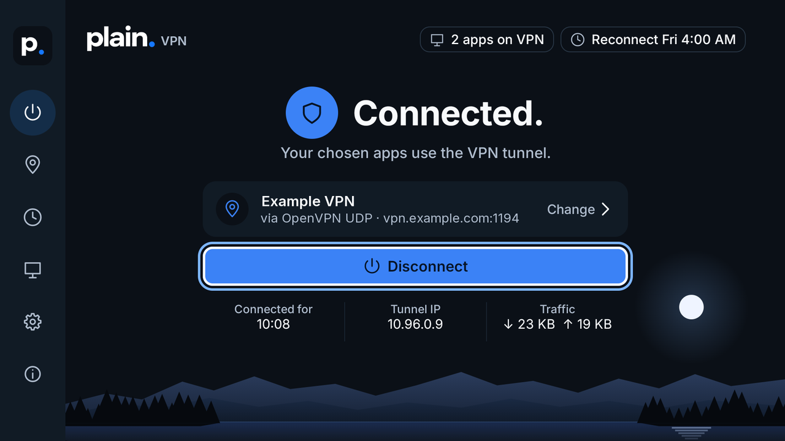
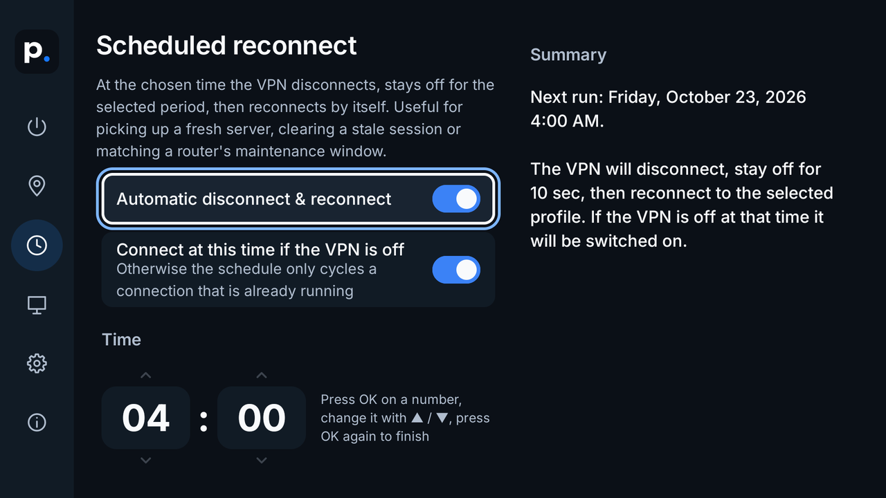
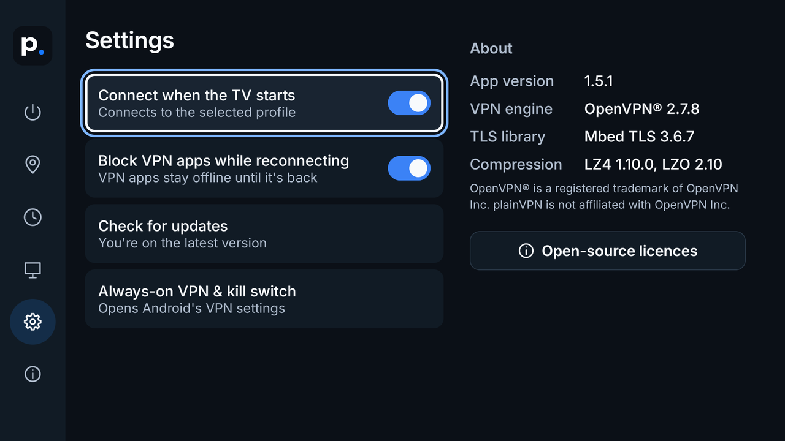

<p align="center">
  <picture>
    <source media="(prefers-color-scheme: dark)" srcset="docs/images/plain-logo-for-dark.svg">
    
  </picture>
</p>

<h1 align="center">plainVPN</h1>

<p align="center">
  A simple, remote-friendly VPN app for Android TV.<br>
  Bring your own OpenVPN® or WireGuard® profile, press Connect, and get back to watching.
</p>

<p align="center">
  <a href="https://github.com/Fraction7551/plainVPN/releases/latest/download/plainVPN.apk"><b>⬇ Download plainVPN.apk</b></a>
  &nbsp;·&nbsp;
  Downloader code <b>6988168</b>
  &nbsp;·&nbsp;
  <a href="https://github.com/Fraction7551/plainVPN/releases/latest">Release notes</a>
</p>

<p align="center">
  
</p>

## Why plainVPN?

I made plainVPN to solve a niche problem of my own: a TV box that should use a VPN for a couple of apps, reconnect on a schedule, and never leak traffic while it does. Most VPN apps are built for phones and are awkward with a remote, so this one is built for the TV from the start. If it's useful to you too, use it or build on it.

## What it does

- **Made for the remote.** Big, clear screens you can drive with the D-pad. No touchscreen, keyboard or account needed.
- **Your own VPN.** Works with standard OpenVPN profiles (`.ovpn` files) and WireGuard configs (`.conf` files) from your VPN provider or your own server. It uses the official OpenVPN and WireGuard engines.
- **Choose which apps use the VPN.** Send only certain apps through the VPN, or everything except a few.
- **Scheduled reconnect.** Disconnect and reconnect at a set time, for example every night at 4 AM, to pick up a fresh server.
- **No leaks while reconnecting.** While the VPN connects, restarts or does its scheduled reconnect, the apps that use it stay offline instead of quietly switching to your normal connection.
- **Comes back by itself.** Reconnects after a dropped connection, a crash or an app update, and after a TV restart if you turn on *Connect when the TV starts*.
- **Easy profile import.** Send profiles from your phone or computer over Wi-Fi, or load them from USB.
- **Updates itself.** New versions show up inside the app and install with one press.

## Getting started

### 1. Install the app

On your TV, open the *Downloader* app and enter the code **6988168**. It always fetches the latest version. Allow installing from Downloader when Android asks.

No Downloader? Open the **[download link](https://github.com/Fraction7551/plainVPN/releases/latest/download/plainVPN.apk)** in any browser app on the TV instead.

Prefer a computer? With network debugging turned on in the TV's developer options:

```
adb connect <your-tv-ip>:5555
adb install plainVPN.apk
```

### 2. Add your VPN profile

Open plainVPN and go to **Profiles**. Pick whichever is easiest:

- **From phone or computer:** open the web address shown on the TV in a browser on the same Wi-Fi, choose your `.ovpn` or `.conf` file and enter the 6-digit PIN from the TV screen.
- **From storage / USB:** pick the file with the TV's file browser, if it has one.
- **Drop folder:** copy the file to `Android/data/dev.ovpntv/files/` (for example with `adb push`), then press **Scan drop folder**.

If an OpenVPN profile needs a username and password, select it and choose **Add username & password**. They're saved on the TV, so you only do this once.

### 3. Connect

Press **Connect**. The first time, Android asks you to allow the VPN connection: press **OK**. That's it.

## A quick look

| Scheduled reconnect | Settings |
|:---:|:---:|
|  |  |
| Pick a time, the days and how long to stay off. | Start on boot, blocking, updates and Android's kill switch. |

## Tips

- **Full kill switch:** for the strongest protection, open **Settings → Always-on VPN & kill switch** and turn on Android's *Always-on VPN* and *Block connections without VPN*, if your TV offers them.
- **Only some apps on the VPN:** go to **Split tunneling** and pick the apps. Changes apply the next time the VPN connects.
- **Something not working?** **Logs** shows what the VPN is doing, step by step.

## Good to know

- **Privacy:** plainVPN has no account, ads, analytics or tracking. Your profiles and passwords stay on your TV and are left out of backups. Apart from your VPN connection, the only thing it contacts is this project's releases on GitHub, to check for updates.
- **Safety:** profiles can't run programs or scripts on your TV. plainVPN removes those parts of a profile (including WireGuard's `PostUp`/`PreDown` commands) and starts OpenVPN with scripts turned off.
- **Not supported (yet):** `dev tap` (layer 2) profiles, because Android's VPN system doesn't support them; `pkcs12` certificate files; password-protected private keys; and one-time-code (OTP) logins.
- **Without "Block VPN apps while reconnecting":** apps use your normal connection while the VPN is down, for example during the scheduled reconnect.

## For developers

<details>
<summary>Project layout, building and how it works</summary>

### Layout

```
plainVPN/
  openvpn-src/openvpn-2.7.8     upstream OpenVPN source (unmodified)
  deps/                         mbedtls-3.6.7, lz4-1.10.0, lzo-2.10 (unmodified)
  toolchain/                    JDK 21 used for the build
  plainvpn/                     this repository (package id dev.ovpntv)
    app/src/main/cpp/           CMake build of OpenVPN + deps, Android config.h
    app/src/main/java/dev/ovpntv/
      vpn/        OpenVpnService (VpnService; OpenVPN and WireGuard sessions), TunConfig, ConfigSanitizer, WireGuard
      schedule/   ReconnectScheduler (alarm-clock alarms), receivers for alarms/boot/clock changes
      importer/   LAN upload server for .ovpn and .conf files
      update/     self-updater (GitHub releases)
      ui/         Compose UI: theme, components, Home/Profiles/Schedule/Split tunnelling/Settings/Logs
    design-tools/ generators for the vector drawables and the TV banner
```

### Build

The native sources sit next to this folder (see Layout). They are the unmodified upstream archives, also attached to every release as `source.zip`: unpack them to `../openvpn-src/openvpn-2.7.8` and `../deps/{mbedtls-3.6.7,lz4-1.10.0,lzo-2.10}`. Then, with JDK 17+ and the Android SDK and NDK r27 installed:

```powershell
$env:JAVA_HOME = "..\toolchain\jdk-21.0.12.1+1"   # or any JDK 17+
.\gradlew.bat assembleRelease     # app\build\outputs\apk\release\app-release.apk
```

Release builds are signed with the key named in `keystore.properties` (not in git). Without that file they fall back to the debug key. `release.py` builds, tests and checks a release, then publishes it with the APK, `version.json` and the complete `source.zip`.

### How it works

OpenVPN is compiled as a PIE executable named `libovpnexec.so`, so that Android extracts it to the native-library directory, the only place an app is allowed to exec from. The service starts it with `--management <socket> unix --management-hold --management-query-passwords --persist-tun` and `--script-security 0`. It then answers OpenVPN's Android requests (`IFCONFIG`, `ROUTE`, `DNSSERVER`, `PROTECTFD`, `OPENTUN`, ...) as described in `openvpn-2.7.8/doc/android.txt`, and passes the tun fd and protected sockets over the UNIX socket as SCM_RIGHTS. Profiles are read with a port of OpenVPN's own config parser (`ConfigSanitizer`), so directives that run programs, load plugins or write files are removed exactly as OpenVPN would see them.

WireGuard profiles run on wireguard-go from the official `com.wireguard.android:tunnel` library, inside the same VpnService, so blocking, split tunnelling, retries and the schedule work the same way. plainVPN builds the tun interface itself and hands its fd to wireguard-go; wg-quick extras such as `PostUp` are dropped.

The design comes from the Plain AI Style Kit; asset generators are in `design-tools/`.

</details>

## License

Copyright (c) 2026 Fraction7551

plainVPN is free software: you can redistribute it and/or modify it under the terms of the GNU General Public License as published by the Free Software Foundation, either version 3 of the License, or (at your option) any later version. See [LICENSE](LICENSE).

plainVPN is distributed in the hope that it will be useful, but **WITHOUT ANY WARRANTY**; without even the implied warranty of MERCHANTABILITY or FITNESS FOR A PARTICULAR PURPOSE. It is provided "as is", and the author is not liable for any damages arising from its use (GPL-3.0 sections 15 and 16).

The bundled components keep their own licences, shown in the app under Settings → Open-source licences: OpenVPN® 2.7.8 (GPL-2.0 with OpenVPN Inc's linking exception), Mbed TLS 3.6.7 (used under GPL-2.0-or-later), LZO 2.10 (GPL-2.0-or-later), LZ4 1.10.0 (BSD-2-Clause), the WireGuard tunnel library (Apache-2.0), wireguard-go (MIT), the Go runtime (BSD-3-Clause), Inter (SIL OFL 1.1), and Kotlin, kotlinx.coroutines, AndroidX and Jetpack Compose (Apache-2.0). OpenVPN runs as a separate program; its complete source and build files are attached to every release as `source.zip`.

OpenVPN® is a registered trademark of OpenVPN Inc. WireGuard® is a registered trademark of Jason A. Donenfeld. plainVPN is not affiliated with either.
